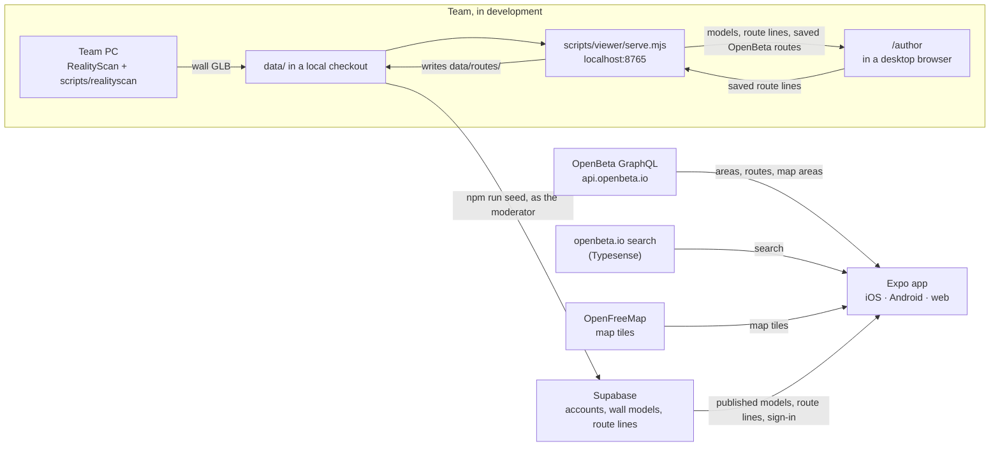
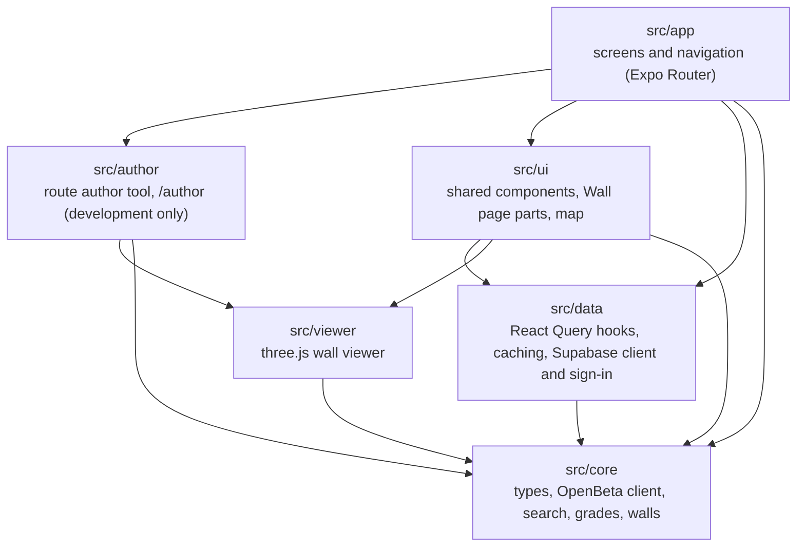
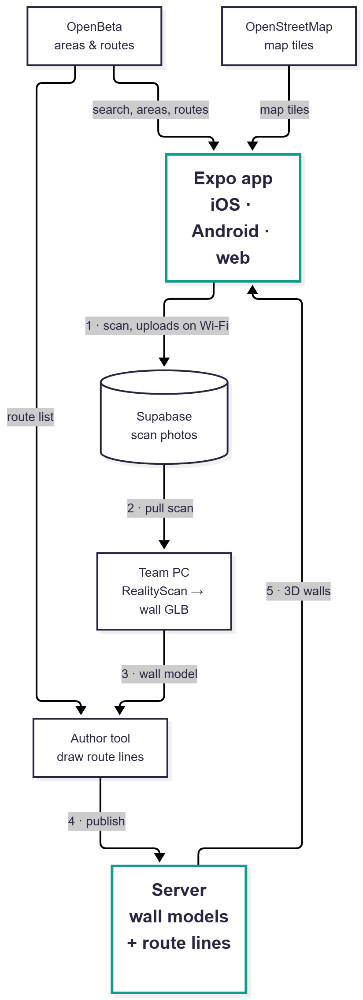

# Architecture

How the pieces fit today, how the app's code is organised, and where the project is heading. The reasons behind each choice are in the [decision records](../adr/).

## Today

- **Route and area data** comes live from OpenBeta, looked up by uuid. Search uses openbeta.io's own search server and falls back to GraphQL area search ([ADR 0003](../adr/0003-openbeta-data.md), [openbeta.md](../openbeta.md))
- **Wall models and route lines** are published to the team's Supabase project, and the app loads them from there ([ADR 0006](../adr/0006-supabase-backend.md)). The working files are in [`data/`](../../data/README.md), which `/author` reads and saves through `serve.mjs`
- **Models** are made on the team PC: photos go through RealityScan and `scripts/realityscan/run.reproject.ps1` to one GLB per wall ([ADR 0001](../adr/0001-photogrammetry.md), [ADR 0005](../adr/0005-wall-model-format.md))
- **Route lines** are drawn on a model in `/author` and saved as `data/routes/<model>.json`. The author tool takes its route list from a saved OpenBeta response, `data/openbeta/date-wall.json`, so for now it only lists Date Wall's routes
- **The backend** is Supabase: team accounts with a moderator, the wall model list, route lines and model files, with access rules in the database ([supabase/README.md](../../supabase/README.md))

## App code

All app code is in `mobile/src/`. Arrows point from a folder to what it imports.

- `src/core` is plain TypeScript with no React, so Node scripts can share it. Lint enforces this
- Screens get data only through the hooks in `src/data`, never from the network directly, so offline storage can be added there later ([ADR 0002](../adr/0002-expo-app.md))
- three.js and MapLibre need a browser, so the wall viewer (`src/viewer/wall-viewer.tsx`) and the map (`src/ui/wall-map.tsx`) are Expo DOM components. They render as-is on the web and in a webview on iOS and Android ([ADR 0004](../adr/0004-wall-viewer.md))
- `src/hooks` and `src/constants` hold the theme and color-scheme helpers

More on each folder in the [app README](../../mobile/README.md#layout).

## Where it's heading

The planned pipeline once climbers can scan walls themselves. Not all of it exists yet:

| Step | Status |
| --- | --- |
| OpenBeta and map tiles into the app | Built. The tiles come from OpenFreeMap, on OpenStreetMap data |
| 1 · Scan in the app, upload on Wi-Fi to Supabase | Milestone 2, in progress. The Supabase project is set up ([ADR 0006](../adr/0006-supabase-backend.md)) |
| 2 · Team PC pulls the scan | Milestone 2 (#46) |
| 3 · Team PC makes the wall model | Built, run by hand ([setup](../setup.md#make-a-wall-model)) |
| 4 · Author tool draws route lines and publishes them | Drawing is built. A wall's first version is published with `npm run seed`; the moderator's review queue in the app is a placeholder so far |
| 5 · Server sends 3D walls to the app | Built: Supabase serves published models and their route lines |
